<div align="center">

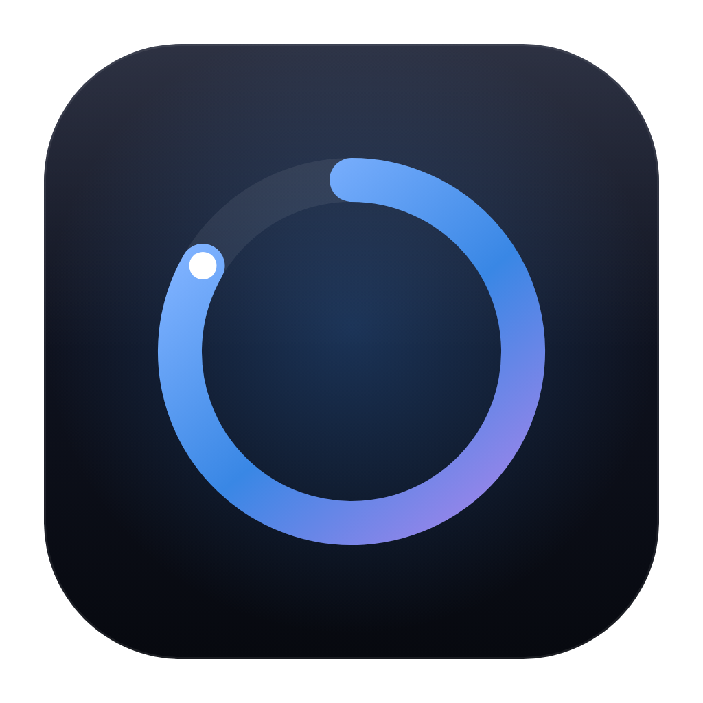

# Kairo

**A calm focus timer that shows you where your time actually goes, privately and on your own device.**

macOS · Windows · Linux · Android · iOS

</div>

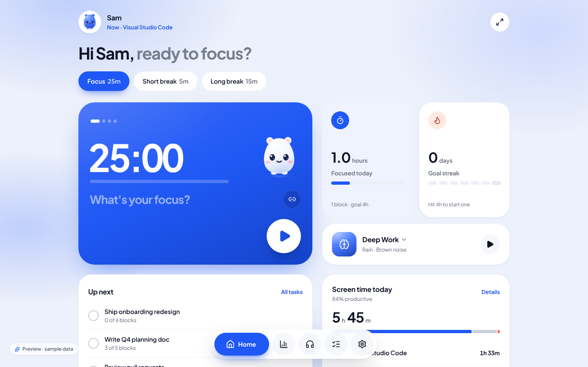

Kairo combines a Pomodoro-style focus timer with automatic time tracking across your apps and websites. It then turns that history into plain-language insights: your sharpest hours, when distractions peak, and which apps cost you the most time. Everything is stored in a local SQLite database. Kairo has no account, no cloud and no analytics, and it makes no network requests unless you turn one on (site icon downloads, or a daily check for new versions).

## Download

Installers for macOS, Windows, Linux and Android are on the [Releases page](../../releases/latest). The release notes explain the one-time confirmation each system asks for, because these builds aren't signed with paid developer certificates yet.

## Features

**Focus**
- Focus, short break and long break phases. Long breaks come every *n* blocks, breaks and focus can start automatically, and you can add 5 minutes on the fly.
- **Finish early:** done in 12 minutes? Finish the block and those 12 minutes are logged as a finished block, credited to its task, and your break starts.
- Set an intention for each block and link it to a task, so blocks count toward the work they were for. The buttons **1–4** on the timer (or the keys <kbd>1</kbd>–<kbd>4</kbd>) pick your top four tasks; an intention that isn't a task yet becomes one with **Add as task**.
- **Voice dictation, on your device.** Tap Kai (or press <kbd>V</kbd>) and say what you're working on; Kai listens until you pause, and the words fill in your focus. Say a task's name or "task two" to link it. In Tasks, the microphone in *Add a task* takes things like "landing page redesign, three blocks". Speech becomes text through [Whisper](https://github.com/openai/whisper) (OpenAI's open speech model, tiny English, 32 MB, via [whisper.cpp](https://github.com/ggml-org/whisper.cpp)) shipped with the app: no audio is stored or sent anywhere. Desktop only; phones have dictation on their keyboard.
- **Kai**, a small focus buddy, keeps you company. Its face and ears follow the timer: curious when idle, calm while you focus, blissful on breaks, all ears while you dictate and asleep when nothing's playing.
- **Tasks** are planned in focus blocks and kept in priority order: drag them by their handle (or use the arrow keys on it). Give a task a day (Today, Tomorrow, This week, Next week or any date, also by saying "…tomorrow" or "by Friday"), a one-line note, and a sound that plays when you focus on it. The **Today** tab shows what's due. The current task sits on its own card with a progress bar per block, and you slide to mark it done.
- The countdown lives in the **menu bar / system tray** and keeps running with the window closed. Click the icon (macOS, Windows) for a small panel with the timer, your top four tasks, today's focus and the app in front; the full menu is on right-click (and on Linux, where trays only show menus).
- **Quick capture** (default <kbd>⌘/Ctrl</kbd> <kbd>⌥/Alt</kbd> <kbd>K</kbd>): a box over whatever you're doing. Type or say a task ("call the gym tomorrow, one block") and press Enter to add it, or <kbd>⇧</kbd> Enter to focus on it now. Press the shortcut again to talk.
- **Global shortcut** (default <kbd>⌘/Ctrl</kbd> <kbd>⇧</kbd> <kbd>Space</kbd>) starts or pauses the timer from any app.
- **Deep focus mode** (<kbd>F</kbd>) leaves only the timer on screen.
- Native notifications when a phase ends. On mobile the OS schedules them, so they fire even if the app is suspended.

**Tracking (on-device)**
- Samples the foreground app about once a second, merges the samples into spans and skips idle time (the idle threshold is configurable). Watching a video or sitting in a call still counts without any input: Kairo checks whether the app in front is keeping the screen awake, as video players and call apps do. **Open at login** (offered during setup) starts Kairo quietly in the menu bar, so the whole day is tracked, not just while the window is open.
- Shows each app's **real icon**, read from the app on your computer (or the launcher on Android) and kept in the local database. Well-known sites show their logo (bundled brand marks from [Simple Icons](https://simpleicons.org), CC0); other sites use the favicon your Chromium-based browser already saved, read from its local cache, or, if you turn on **Download site icons**, the site's own icon. Categories have their own icons.
- Detects websites in browsers. Window titles map to known sites on Windows and Linux. On macOS, Kairo reads the current tab's domain from Safari, Chrome, Arc, Edge, Brave and others once you allow it (macOS asks once per browser).
- Classifies hundreds of apps and sites into 15 categories, each scored *productive*, *neutral* or *distracting*. You can re-categorise any app or site, and the change rewrites your whole history.
- Pause tracking for 30 or 60 minutes. Tap any app or site in Stats or Apps & sites to exclude it (Kairo deletes its history and stops recording it), or just delete its history once and keep tracking it.
- **Android:** per-app usage through `UsageStatsManager` once you grant *Usage access*.

**Understand**
- **Home** shows today's screen time, how it split, and the apps that took the most of it.
- **Daily summary** at a time you pick (6 pm by default): a notification with the day's headline, then a summary screen with screen time and its hourly shape, focus vs. goal, tasks done, distracting time vs. budget, your sharpest hour, and where the time went.
- **Stats, today:** productive time, a productivity score, focus vs. goal, a distraction budget, app switches, a timeline of the day, an hour-by-hour breakdown, top apps & sites, categories and focus blocks.
- **Stats, 7 or 30 days:** trends against the previous period, a daily breakdown, a weekday × hour *focus rhythm* heatmap, focus time vs. goal, *where time leaks*, and generated suggestions such as peak hours, distraction peaks, context switching, block follow-through, late nights and communication load.
- **Focus persona:** a summary of your working style (for example *Early Bird Deep Diver*), saved as a shareable image that contains no app names, sites or timestamps.
- **Weekly review** (Sunday evening by default, or any day): focus this week against the last, your best day, goal days, tasks done, what pulled you away, and a moment to put next week's tasks on Monday.
- **Limits per category**, e.g. Social media 30 minutes a day: a heads-up near each limit, and its progress in Stats.
- **Edit your history:** add time Kairo couldn't see (a meeting, a call, reading on paper), move or delete an entry, and point a focus block at the right task, from the Stats timeline. Time you add replaces whatever was recorded then, so nothing counts twice.
- **Smart nudges:** *Focus guard* nudges you if you drift to a distracting app during a block. Kairo also suggests a block after a long distraction and a break after a long stretch, and lets you know once when the day's distraction budget is used up.

**Sound**
- 16 soundscapes synthesised on the device in real time: rain, thunder, ocean, wind, fireplace, stream, forest, night, a café, a train, a library, white / pink / brown noise, binaural beats and an ambient pad. There are no audio files and nothing is streamed.
- Mix any combination or start from a preset (Deep Work, Rainy Night, Ocean Calm, Forest Morning, Campfire, Flow State, Corner Café, Night Train, Reading Room).
- A stop timer (15, 30 or 60 minutes, or the end of the block). Optionally starts with a focus block and fades out on breaks. Choose a bell, soft or digital chime.

**Your data**
- Export everything as JSON or CSV, and import a JSON export on another computer (anything already there is skipped).
- **Weekly backups** of the database on your computer (the last four are kept); put any of them back from Settings.
- Search in Settings (<kbd>/</kbd> or <kbd>⌘/Ctrl</kbd> <kbd>F</kbd>). Set a retention period, or delete everything in one click.

| Stats | Tasks |
| --- | --- |
| 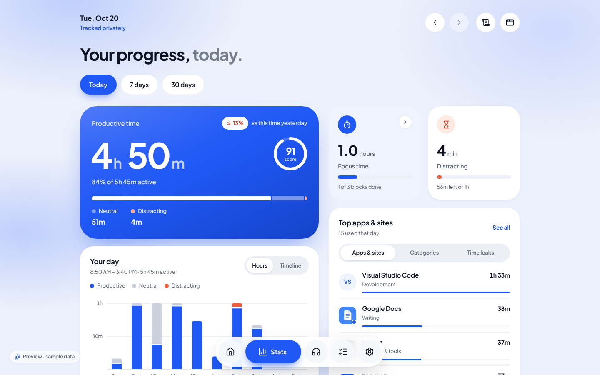 | 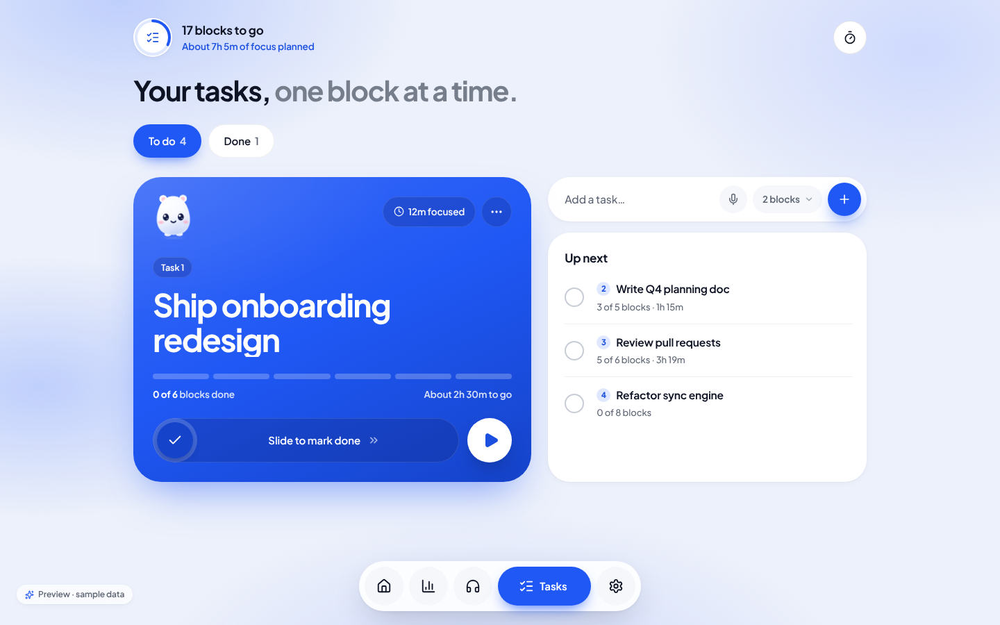 |
| 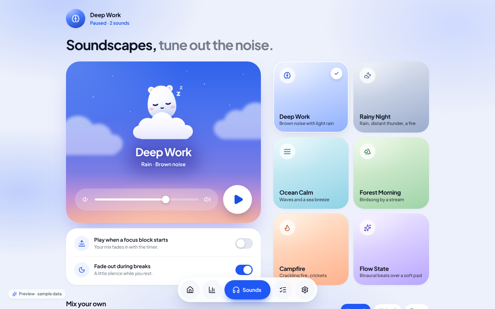 | 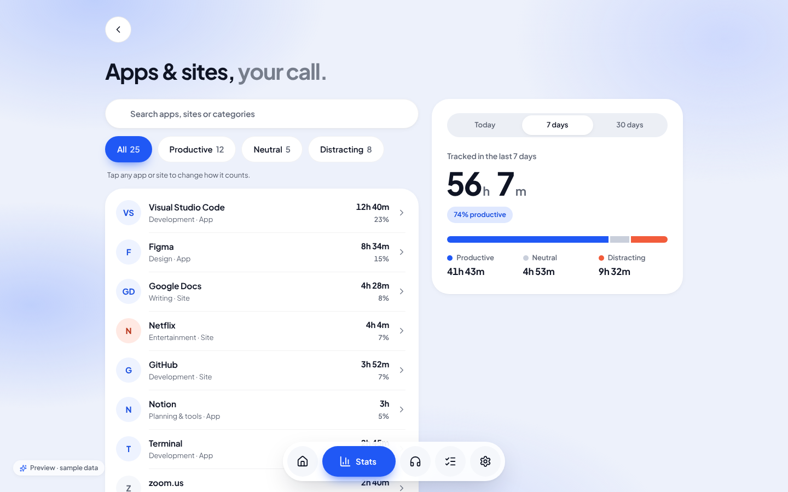 |
| 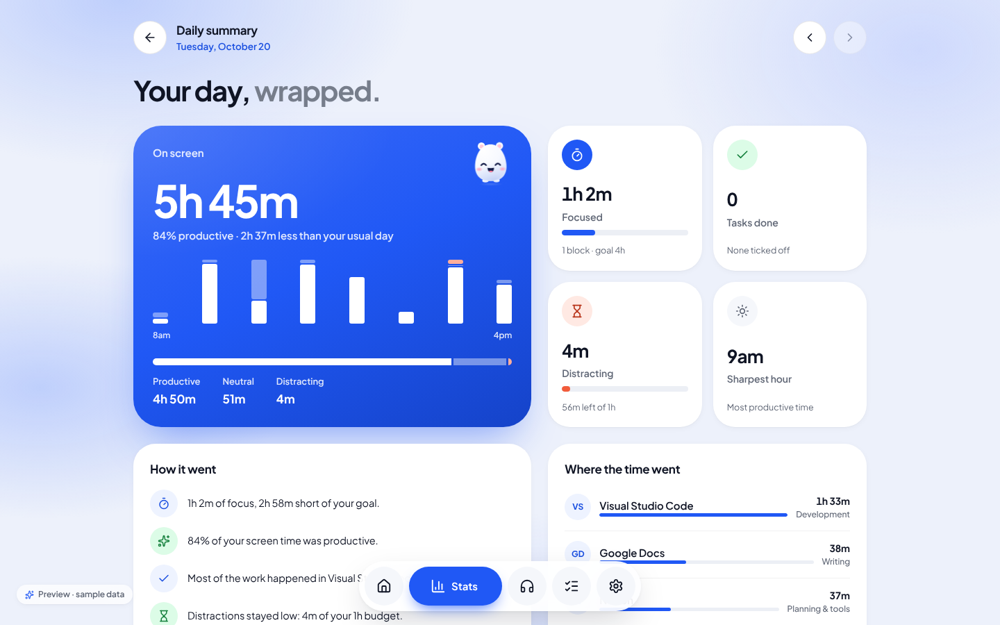 | 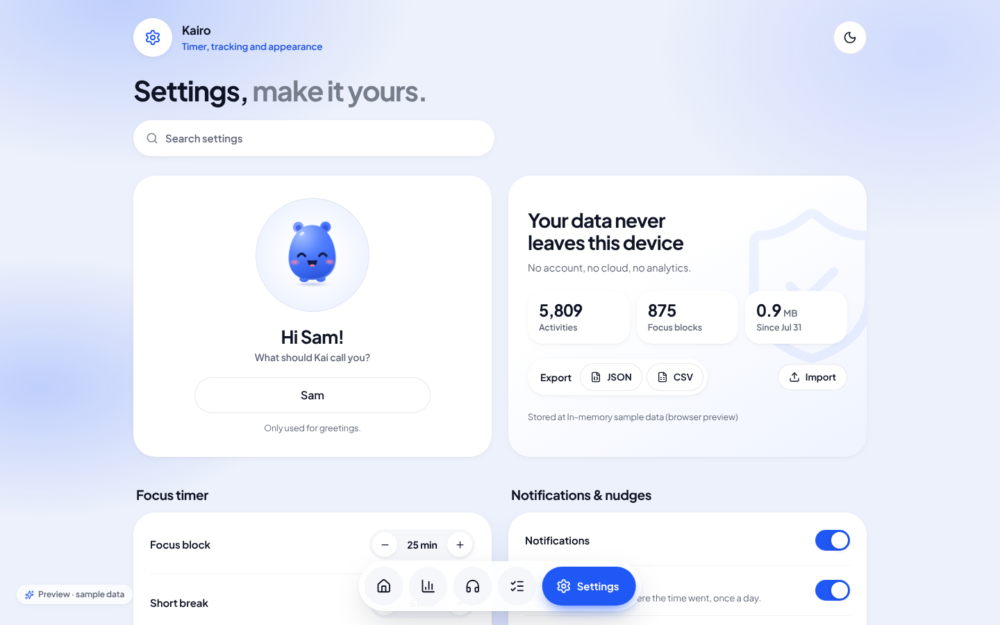 |

**Menu bar panel and quick capture**

<p align="center">
  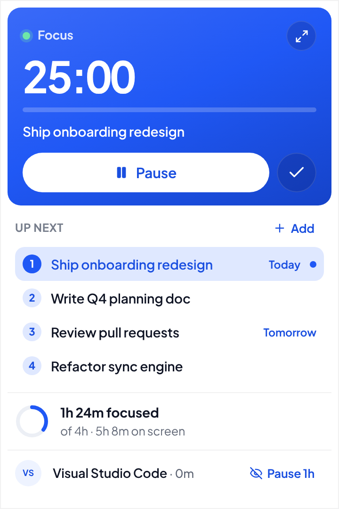
  &nbsp;
  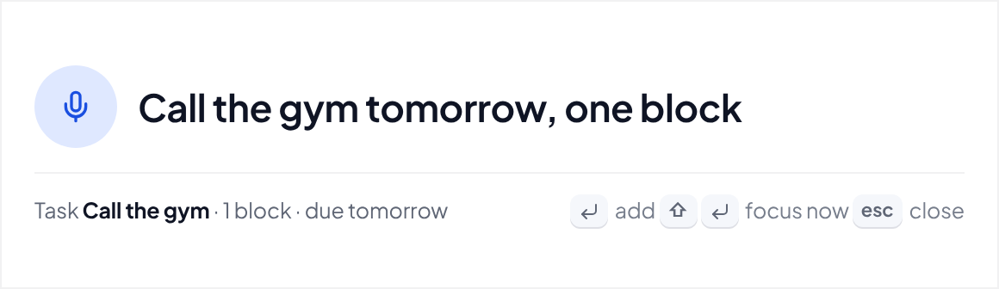
</p>

**Dark theme**

| | |
| --- | --- |
| 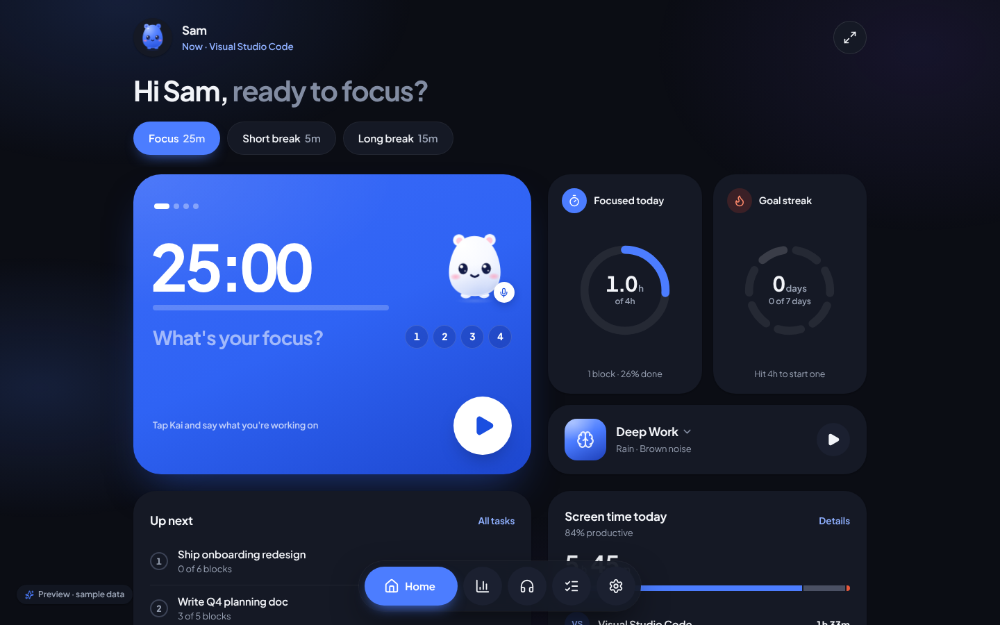 | 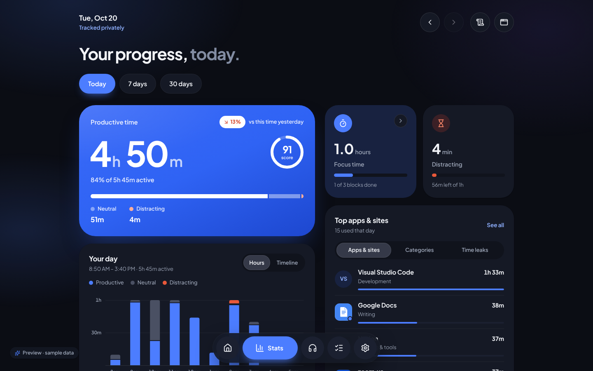 |

<p align="center">
  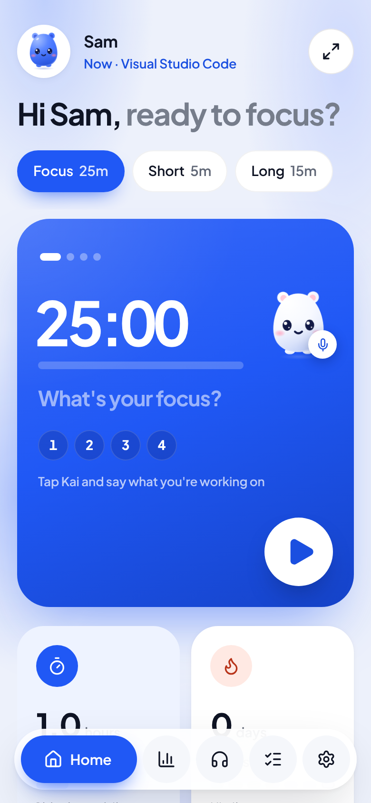
  &nbsp;
  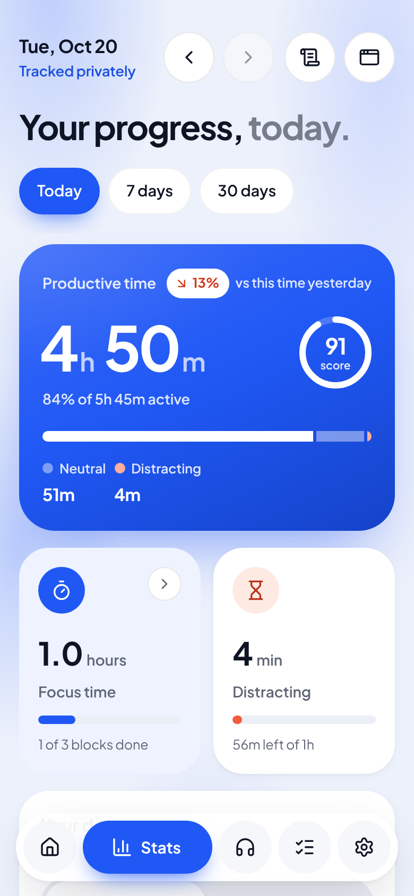
  &nbsp;
  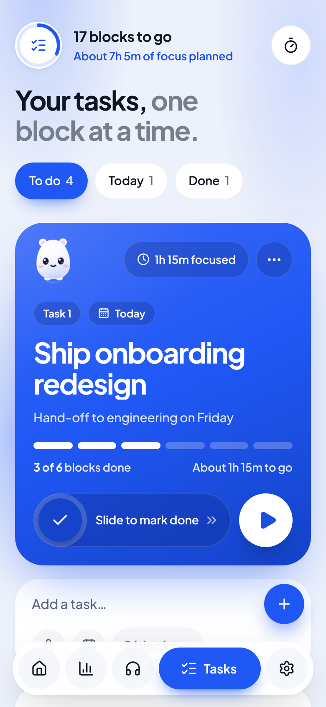
</p>

## Platform support

| | Timer, tray & sounds | App & website tracking | Notes |
| --- | --- | --- | --- |
| **macOS** 11+ | ✅ menu bar countdown | ✅ apps and sites | Optional Automation permission to read exact browser domains. App Nap is disabled so tracking stays accurate in the background. |
| **Windows** 10/11 | ✅ tray | ✅ apps and sites | |
| **Linux** | ✅ tray | ✅ on X11 | Wayland compositors don't expose the focused window to apps. |
| **Android** 7+ | ✅ | ✅ per-app via Usage access | Synced from the OS each time Kairo is opened. |
| **iOS / iPadOS** | ✅ | ❌ | Apple only exposes Screen Time inside a sandboxed report extension, so no app can read it. Kairo records your focus blocks on iPhone. |

## Privacy

- **No network access by default.** The app has no server, telemetry or crash reporting. The Content Security Policy in `src-tauri/tauri.conf.json` blocks all remote connections from the interface. Two features can go online, both off unless you turn them on: **Download site icons** (see below) and **Check for updates**.
- **Update check (opt-in).** Once a day, one HTTPS request to GitHub's releases API asks for the latest version number. It carries nothing about you (just "Kairo" and its version, as GitHub requires). If there's a newer version, Kairo says so; nothing is downloaded or installed by itself.
- **One local file.** Data lives in `kairo.db` in the OS app-data folder, with weekly backups next to it in `backups/`. Settings shows the path and size.
- **Site icons.** Logos are bundled with the app or copied from your browser's own favicon cache on this computer. Only if you turn on **Download site icons** does Kairo ask a site with no saved icon for its own icon: requests to that site alone, over HTTPS, through the system's `curl`, carrying nothing about you.
- **Microphone only while you dictate.** Speech is turned into text on your device by a bundled Whisper model; the audio is never saved or sent.
- **Minimal by default.** Kairo stores app names and website domains. Window titles are off unless you turn them on, and full URLs are never stored.
- **Least-privilege permissions.** The webview can only write files to a path you just picked in a save dialog, and an import reads only the file you picked. The menu bar panel and quick capture have no file or dialog access at all.
- **You're in control.** Pause tracking, exclude apps and sites (which deletes their history), delete any one app's or site's history, choose a retention period, export, or delete everything.

## Getting started

### Try the UI in a browser

```bash
npm install
npm run dev        # http://localhost:1420 (sample data and a working timer & sounds)
```

The browser preview runs on deterministic sample data so you can explore every screen. Real tracking needs the native app.

### Run the native app

Prerequisites: [Node 20+](https://nodejs.org), [Rust](https://rustup.rs), the [Tauri system dependencies](https://tauri.app/start/prerequisites/) for your OS, and CMake (voice dictation builds whisper.cpp). On Linux also `libasound2-dev` for the microphone.

```bash
npm install          # also downloads the voice model (32 MB, checksum-verified) into src-tauri/voice/
npm run tauri dev
```

`npm run voice-model` fetches the model again if it's missing. Set `KAIRO_SKIP_VOICE_MODEL=1` to skip it for mobile-only builds.

### Build installers

```bash
npm run tauri build                                   # current OS: .dmg / .msi + .exe / .deb + .AppImage + .rpm
npm run tauri build -- --target universal-apple-darwin  # one macOS build for Apple silicon + Intel
```

### Mobile

```bash
# Android (needs Android Studio / SDK + NDK, JAVA_HOME and NDK_HOME set)
npm run tauri android init
cp -R src-tauri/icons/android/. src-tauri/gen/android/app/src/main/res/
npm run tauri android dev
npm run tauri android build -- --apk

# iOS (needs Xcode and an Apple developer team for device builds)
npm run tauri ios init
npm run tauri ios dev
```

CI (`.github/workflows/build.yml`) builds macOS (Apple silicon + Intel), Windows, Linux, a release Android APK and an iOS simulator build on every push, and keeps the installers as workflow artifacts.

**Publishing a release:** bump `version` in `src-tauri/tauri.conf.json` (and `package.json`) and push to the default branch. Once every platform builds, CI publishes `v<version>` as a GitHub release with the installers, a `SHA256SUMS.txt` file and the notes from `.github/release-notes.md`. Pushes that don't change the version skip publishing. Pushing a `v<version>` tag publishes too.

**Signing:** macOS builds are ad-hoc signed and Windows builds are unsigned. For store-ready builds you need an Apple Developer ID with notarisation and a Windows code-signing certificate; see the [Tauri distribution guide](https://tauri.app/distribute/). The Android APK is signed with the key in these repository secrets: `ANDROID_KEYSTORE_BASE64`, `ANDROID_KEYSTORE_PASSWORD`, `ANDROID_KEY_ALIAS` and, if it differs from the store password, `ANDROID_KEY_PASSWORD`. Without them, each build is signed with a one-off key, and a new version won't install over an older one. Create a key once and keep a backup of it:

```bash
keytool -genkeypair -storetype PKCS12 -keystore kairo-release.keystore -alias kairo \
  -keyalg RSA -keysize 2048 -validity 10000 -dname "CN=Kairo"
base64 -w0 kairo-release.keystore   # paste the output into ANDROID_KEYSTORE_BASE64
```

## Architecture

```
src/                      React 19 + TypeScript UI (Vite)
  lib/backend/            one Backend interface, two implementations:
    native.ts               Tauri IPC → Rust core
    demo.ts, seed.ts        browser preview with sample data + TS timer twin
  lib/insights.ts         rule-based insight + persona engine (pure, on-device)
  lib/analytics.ts        day stats, productivity score, rhythm matrix
  lib/audio/              procedural soundscape synthesis + mixer + chimes
  components/charts/      SVG charts: timeline, stacked columns, heatmap, timer ring
  views/                  Focus, Today, Insights, Apps & Sites, Tasks, Sounds, Settings
src-tauri/                Rust core (Tauri 2)
  src/timer.rs            focus timer state machine (drives tray + notifications)
  src/tracker.rs          foreground-app sampler, idle detection, nudges
  src/db.rs               SQLite schema, range queries, rules, export
  src/categories.rs       default app/site classification
  src/sites.rs            website detection from titles and URLs
  src/tray.rs             menu-bar / tray countdown and controls
  src/panel.rs            the tray panel and quick-capture windows
  src/daily.rs            daily summary, weekly review, budget and limit heads-ups
  src/backups.rs          weekly local backups and restore
  src/net.rs, update.rs   opt-in network use (system curl) and the opt-in update check
  src/voice.rs            on-device dictation: microphone (cpal) → Whisper (whisper.cpp)
  src/playback.rs         "is the app in front playing video?" so watching isn't idle
  src/icons/              app icons, browser-cached favicons, optional icon download
plugins/tauri-plugin-screentime/
  android/                Kotlin plugin over UsageStatsManager
```

The timer runs in Rust, not in the webview, so the countdown, tray title and notifications keep working when the window is hidden. The UI subscribes to `timer://state` events and renders the countdown from `endsAt`.

**Productivity score** = (productive + ½ × neutral) ÷ active time × 100.

## Customising

- **Name & identity:** set `productName` and `identifier` in `src-tauri/tauri.conf.json`, then regenerate icons with `npx tauri icon branding/icon-1024.png`.
- **Default categories:** `src-tauri/src/categories.rs`. Users can override any app or site from the Apps & Sites screen.
- **Design:** the design system is described in [`docs/DESIGN.md`](docs/DESIGN.md). Tokens for the light and dark themes are in `src/styles/tokens.css`.

## Tests

```bash
npm run typecheck
cd src-tauri && cargo test && cargo clippy --all-targets -- -D warnings
```

## Credits

- Voice dictation runs [Whisper](https://github.com/openai/whisper) (© OpenAI, MIT) through [whisper.cpp](https://github.com/ggml-org/whisper.cpp) (© The ggml authors, MIT), using the `ggml-tiny.en-q5_1` model.
- Site logos come from [Simple Icons](https://simpleicons.org) (CC0); each brand belongs to its owner.
