<div align="center">

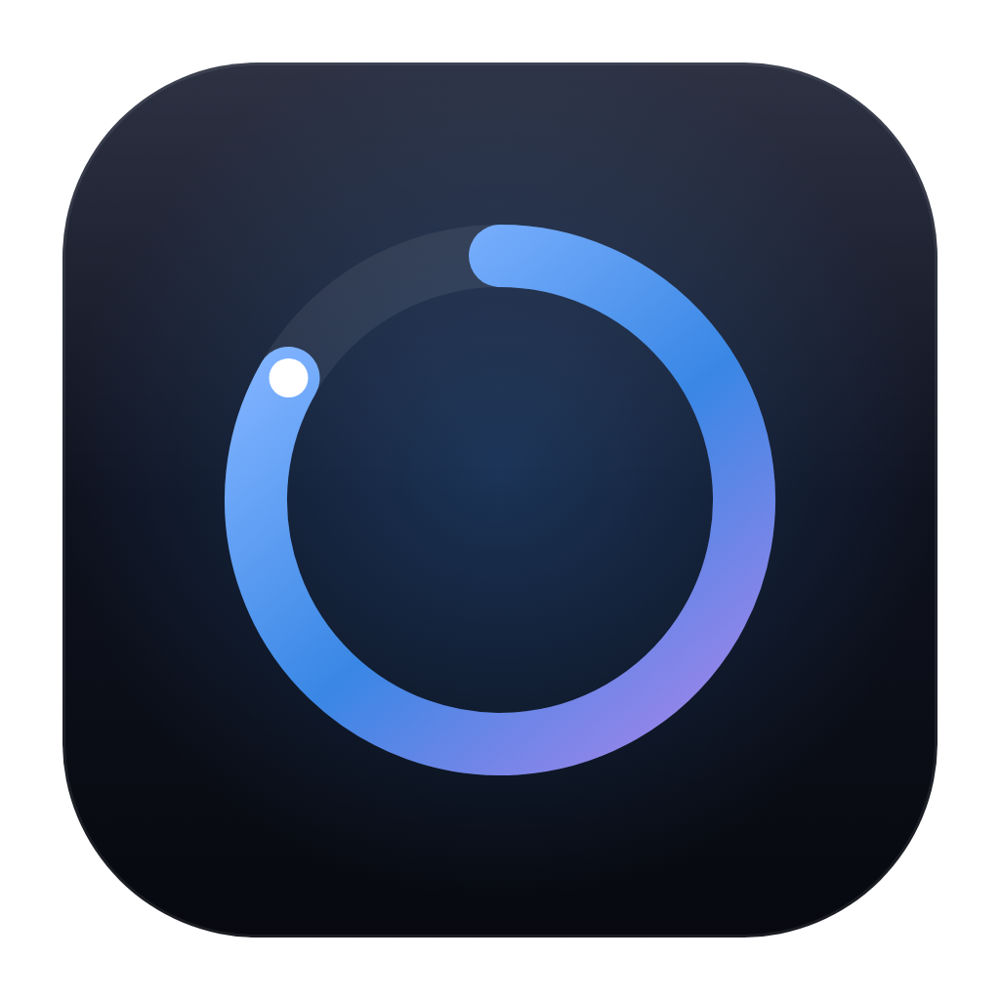

# Kairo

**A calm focus timer that shows you where your time actually goes, privately and on your own device.**

macOS · Windows · Linux · Android · iOS

</div>

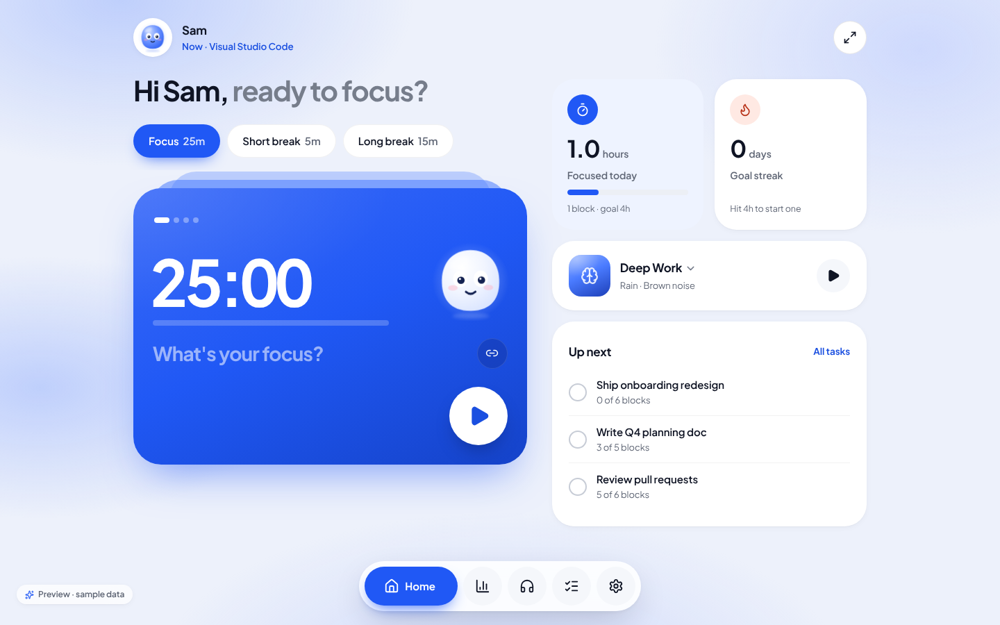

Kairo combines a Pomodoro-style focus timer with automatic time tracking across your apps and websites. It then turns that history into plain-language insights: your sharpest hours, when distractions peak, and which apps cost you the most time. Everything is stored in a local SQLite database. Kairo has no account, no cloud and no analytics, and it never makes a network request.

## Download

Installers for macOS, Windows, Linux and Android are on the [Releases page](../../releases/latest). The release notes explain the one-time confirmation each system asks for, because these builds aren't signed with paid developer certificates yet.

## Features

**Focus**
- Focus, short break and long break phases. Long breaks come every *n* blocks, breaks and focus can start automatically, and you can add 5 minutes on the fly.
- Set an intention for each block and link it to a task, so blocks count toward the work they were for.
- **Kai**, a small focus buddy, keeps you company. Its face follows the timer: curious when idle, content while you focus and blissful on breaks.
- **Tasks** are planned in focus blocks. The current task sits on its own card with a progress bar per block, and you slide to mark it done.
- The countdown lives in the **menu bar / system tray** and keeps running with the window closed. The tray menu has start, pause, skip, reset and break controls.
- **Global shortcut** (default <kbd>⌘/Ctrl</kbd> <kbd>⇧</kbd> <kbd>Space</kbd>) starts or pauses the timer from any app.
- **Deep focus mode** (<kbd>F</kbd>) leaves only the timer on screen.
- Native notifications when a phase ends. On mobile the OS schedules them, so they fire even if the app is suspended.

**Tracking (on-device)**
- Samples the foreground app about once a second, merges the samples into spans and skips idle time (the idle threshold is configurable).
- Detects websites in browsers. Window titles map to known sites on every platform. On macOS you can opt in to reading the exact front-tab domain from Safari, Chrome, Arc, Edge and Brave.
- Classifies hundreds of apps and sites into 15 categories, each scored *productive*, *neutral* or *distracting*. You can re-categorise any app or site, and the change rewrites your whole history.
- Pause tracking for 30 or 60 minutes. Excluding an app deletes its history and stops recording it.
- **Android:** per-app usage through `UsageStatsManager` once you grant *Usage access*.

**Understand**
- **Stats, today:** productive time, a productivity score, focus vs. goal, a distraction budget, app switches, a timeline of the day, an hour-by-hour breakdown, top apps & sites, categories and focus blocks.
- **Stats, 7 or 30 days:** trends against the previous period, a daily breakdown, a weekday × hour *focus rhythm* heatmap, focus time vs. goal, *where time leaks*, and generated suggestions such as peak hours, distraction peaks, context switching, block follow-through, late nights and communication load.
- **Focus persona:** a summary of your working style (for example *Early Bird Deep Diver*), saved as a shareable image that contains no app names, sites or timestamps.
- **Smart nudges:** *Focus guard* nudges you if you drift to a distracting app during a block. Kairo also suggests a block after a long distraction and a break after a long stretch.

**Sound**
- 13 soundscapes synthesised on the device in real time: rain, thunder, ocean, wind, fireplace, stream, forest, night, white / pink / brown noise, binaural beats and an ambient pad. There are no audio files and nothing is streamed.
- Mix any combination or start from a preset (Deep Work, Rainy Night, Ocean Calm, Forest Morning, Campfire, Flow State).
- Optionally starts with a focus block and fades out on breaks. Choose a bell, soft or digital chime.

**Your data**
- Export everything as JSON or CSV. Set a retention period, or delete everything in one click.

| Stats | Tasks |
| --- | --- |
| 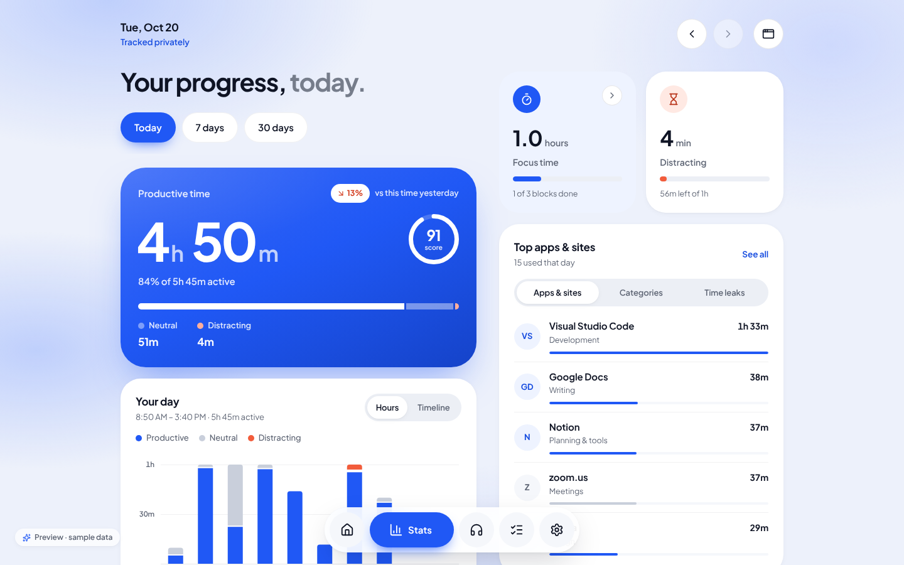 | 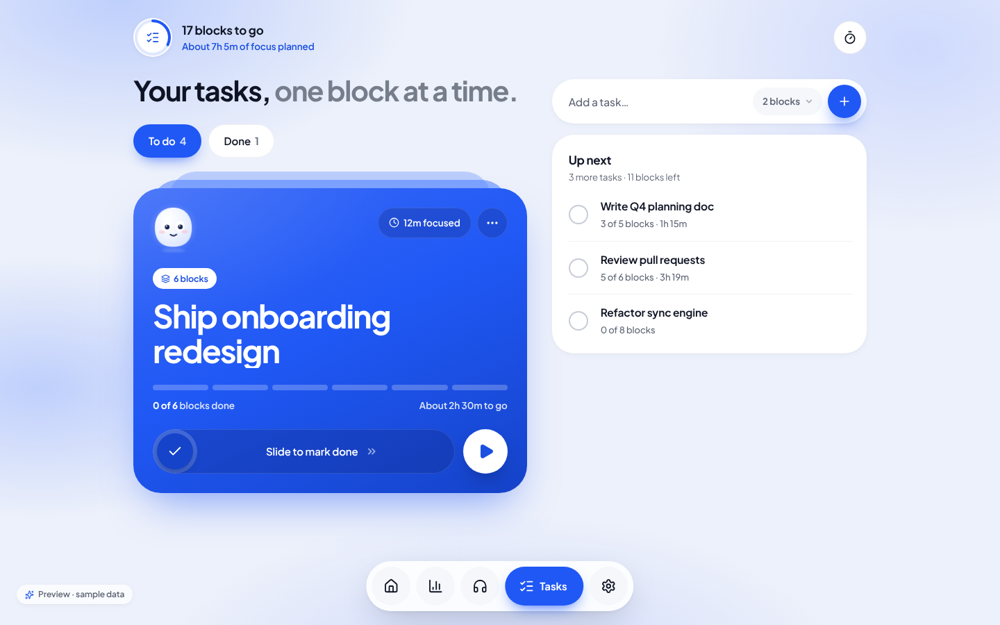 |
| 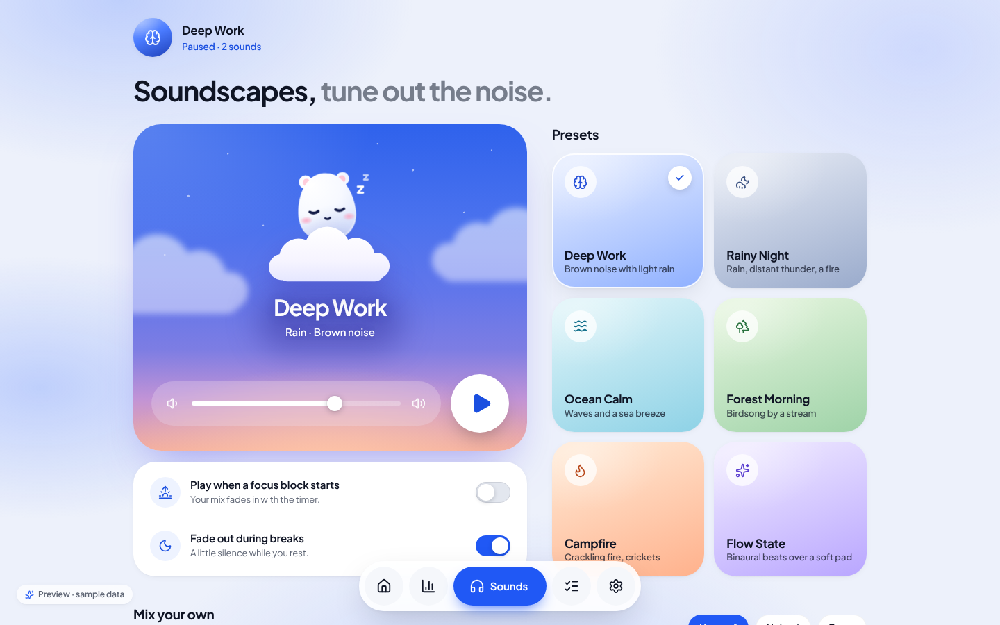 | 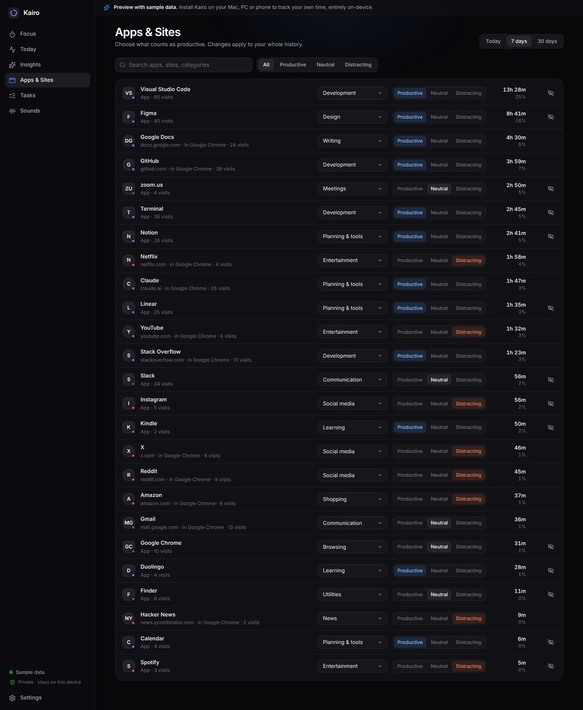 |
| 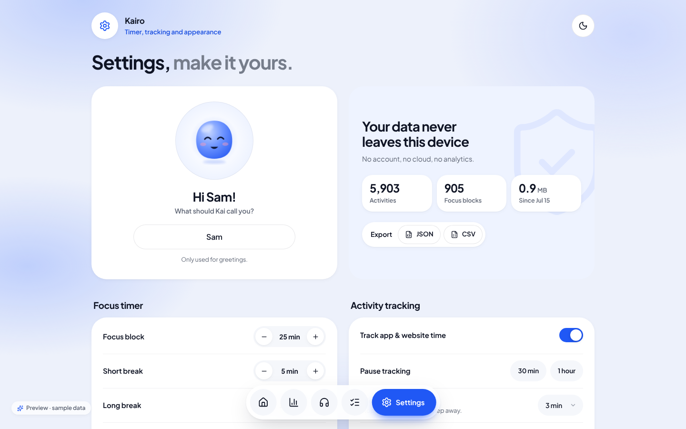 | 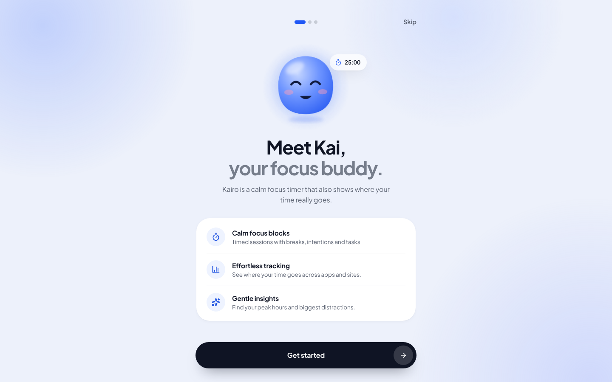 |

**Dark theme**

| | |
| --- | --- |
| 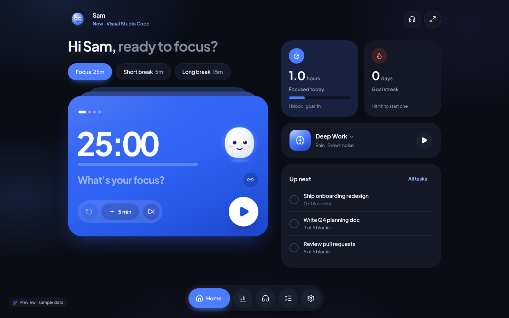 | 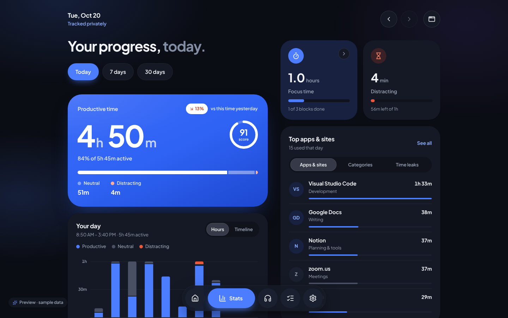 |

<p align="center">
  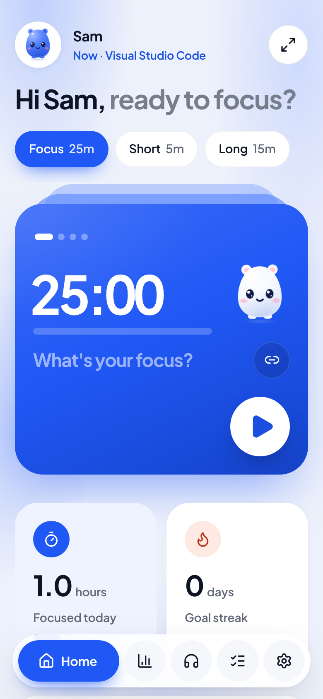
  &nbsp;
  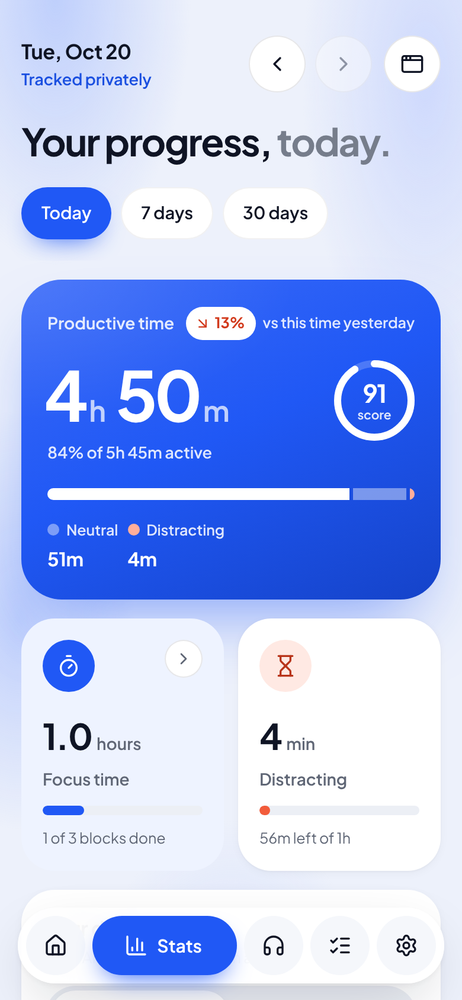
  &nbsp;
  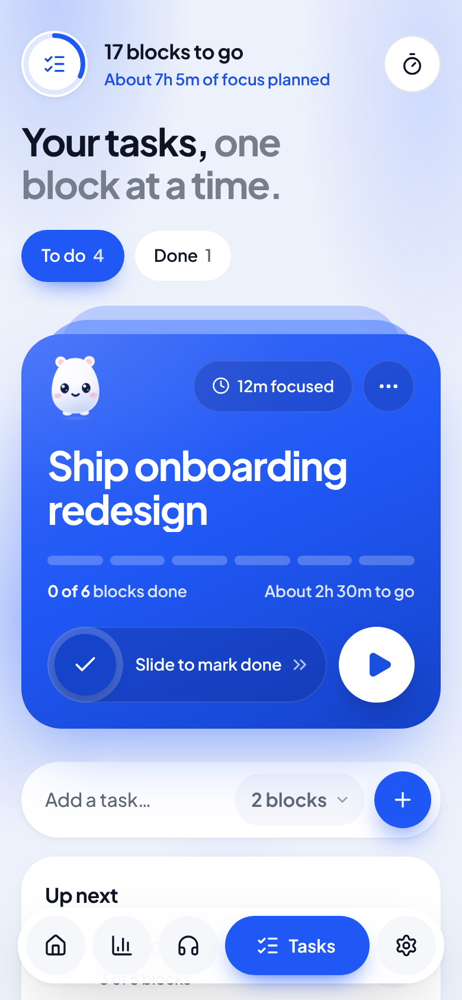
</p>

## Platform support

| | Timer, tray & sounds | App & website tracking | Notes |
| --- | --- | --- | --- |
| **macOS** 11+ | ✅ menu bar countdown | ✅ apps and sites | Optional Automation permission to read exact browser domains. App Nap is disabled so tracking stays accurate in the background. |
| **Windows** 10/11 | ✅ tray | ✅ apps and sites | |
| **Linux** | ✅ tray | ✅ on X11 | Wayland compositors don't expose the focused window to apps. |
| **Android** 7+ | ✅ | ✅ per-app via Usage access | Synced from the OS each time Kairo is opened. |
| **iOS / iPadOS** | ✅ | ❌ | Apple only exposes Screen Time inside a sandboxed report extension, so no app can read it. Kairo records your focus blocks on iPhone. |

## Privacy

- **No network access.** The app has no server, telemetry, crash reporting or update pings. The Content Security Policy in `src-tauri/tauri.conf.json` blocks all remote connections.
- **One local file.** Data lives in `kairo.db` in the OS app-data folder. Settings → Privacy & data shows the path and size.
- **Minimal by default.** Kairo stores app names and website domains. Window titles are off unless you turn them on, and full URLs are never stored.
- **Least-privilege permissions.** The webview can only write files to a path you just picked in a save dialog.
- **You're in control.** Pause tracking, exclude apps (which deletes their history), choose a retention period, export, or delete everything.

## Getting started

### Try the UI in a browser

```bash
npm install
npm run dev        # http://localhost:1420 (sample data and a working timer & sounds)
```

The browser preview runs on deterministic sample data so you can explore every screen. Real tracking needs the native app.

### Run the native app

Prerequisites: [Node 20+](https://nodejs.org), [Rust](https://rustup.rs), and the [Tauri system dependencies](https://tauri.app/start/prerequisites/) for your OS.

```bash
npm install
npm run tauri dev
```

### Build installers

```bash
npm run tauri build                                   # current OS: .dmg / .msi + .exe / .deb + .AppImage + .rpm
npm run tauri build -- --target universal-apple-darwin  # one macOS build for Apple silicon + Intel
```

### Mobile

```bash
# Android (needs Android Studio / SDK + NDK, JAVA_HOME and NDK_HOME set)
npm run tauri android init
cp -R src-tauri/icons/android/. src-tauri/gen/android/app/src/main/res/
npm run tauri android dev
npm run tauri android build -- --apk

# iOS (needs Xcode and an Apple developer team for device builds)
npm run tauri ios init
npm run tauri ios dev
```

CI (`.github/workflows/build.yml`) builds macOS (Apple silicon + Intel), Windows, Linux, a release Android APK and an iOS simulator build on every push, and keeps the installers as workflow artifacts.

**Publishing a release:** bump `version` in `src-tauri/tauri.conf.json` (and `package.json`) and push to the default branch. Once every platform builds, CI publishes `v<version>` as a GitHub release with the installers, a `SHA256SUMS.txt` file and the notes from `.github/release-notes.md`. Pushes that don't change the version skip publishing. Pushing a `v<version>` tag publishes too.

**Signing:** macOS builds are ad-hoc signed and Windows builds are unsigned. For store-ready builds you need an Apple Developer ID with notarisation and a Windows code-signing certificate; see the [Tauri distribution guide](https://tauri.app/distribute/). The Android APK is signed with the key in these repository secrets: `ANDROID_KEYSTORE_BASE64`, `ANDROID_KEYSTORE_PASSWORD`, `ANDROID_KEY_ALIAS` and, if it differs from the store password, `ANDROID_KEY_PASSWORD`. Without them, each build is signed with a one-off key, and a new version won't install over an older one. Create a key once and keep a backup of it:

```bash
keytool -genkeypair -storetype PKCS12 -keystore kairo-release.keystore -alias kairo \
  -keyalg RSA -keysize 2048 -validity 10000 -dname "CN=Kairo"
base64 -w0 kairo-release.keystore   # paste the output into ANDROID_KEYSTORE_BASE64
```

## Architecture

```
src/                      React 19 + TypeScript UI (Vite)
  lib/backend/            one Backend interface, two implementations:
    native.ts               Tauri IPC → Rust core
    demo.ts, seed.ts        browser preview with sample data + TS timer twin
  lib/insights.ts         rule-based insight + persona engine (pure, on-device)
  lib/analytics.ts        day stats, productivity score, rhythm matrix
  lib/audio/              procedural soundscape synthesis + mixer + chimes
  components/charts/      SVG charts: timeline, stacked columns, heatmap, timer ring
  views/                  Focus, Today, Insights, Apps & Sites, Tasks, Sounds, Settings
src-tauri/                Rust core (Tauri 2)
  src/timer.rs            focus timer state machine (drives tray + notifications)
  src/tracker.rs          foreground-app sampler, idle detection, nudges
  src/db.rs               SQLite schema, range queries, rules, export
  src/categories.rs       default app/site classification
  src/sites.rs            website detection from titles and URLs
  src/tray.rs             menu-bar / tray countdown and controls
plugins/tauri-plugin-screentime/
  android/                Kotlin plugin over UsageStatsManager
```

The timer runs in Rust, not in the webview, so the countdown, tray title and notifications keep working when the window is hidden. The UI subscribes to `timer://state` events and renders the countdown from `endsAt`.

**Productivity score** = (productive + ½ × neutral) ÷ active time × 100.

## Customising

- **Name & identity:** set `productName` and `identifier` in `src-tauri/tauri.conf.json`, then regenerate icons with `npx tauri icon branding/icon-1024.png`.
- **Default categories:** `src-tauri/src/categories.rs`. Users can override any app or site from the Apps & Sites screen.
- **Design:** the design system is described in [`docs/DESIGN.md`](docs/DESIGN.md). Tokens for the light and dark themes are in `src/styles/tokens.css`.

## Tests

```bash
npm run typecheck
cd src-tauri && cargo test && cargo clippy --all-targets -- -D warnings
```
